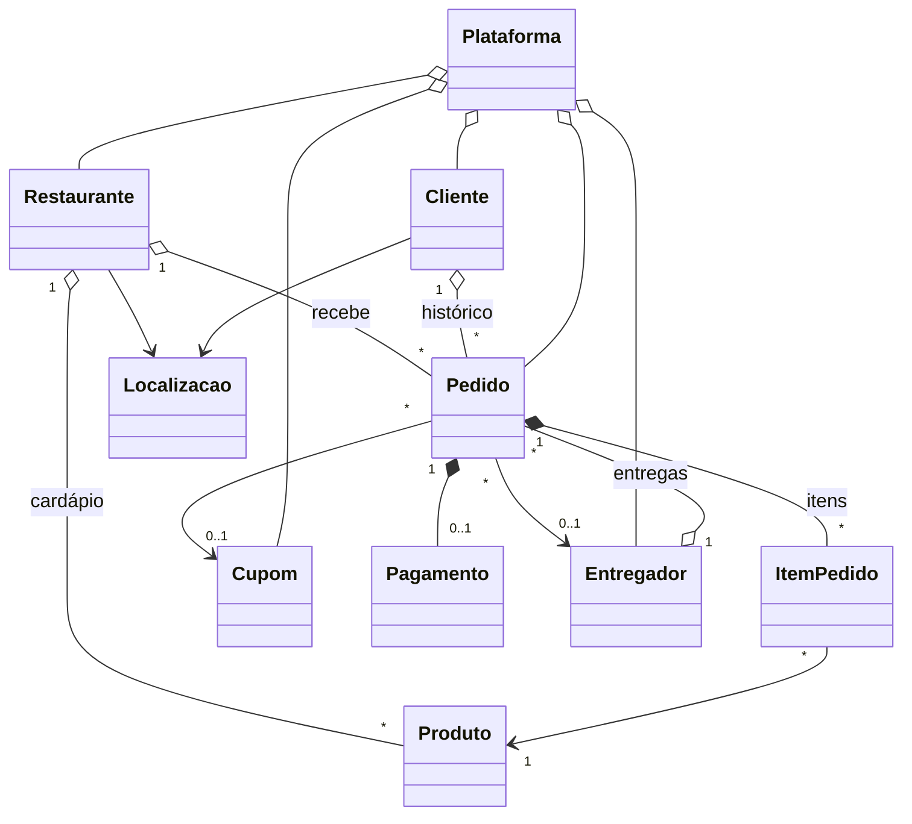

# Entrega Já – Sistema de Gerenciamento de Delivery

Sistema em Java (POO) executado no terminal para gerenciar uma plataforma de delivery de comida: restaurantes, cardápios, clientes, entregadores, cupons e o ciclo completo do pedido, do carrinho à avaliação, com relatórios e exportação para CSV.

## Integrantes

| Integrante | Função | Responsável por |
|---|---|---|
| Vitor Bismarck | Modelagem e regras de negócio | Pacote `modelo` (Pedido, ItemPedido, Produto, Restaurante, Cupom, Cliente, NivelFidelidade) e testes JUnit das regras |
| José Scaff | Serviços, interface e integrações | Pacotes `servico` (Plataforma, Relatorios), `io` (importação/exportação CSV), `app` (menus), classe Entregador e README |

## Descrição do problema

Restaurantes pequenos e médios que fazem entregas costumam controlar pedidos em cadernos, planilhas ou mensagens de WhatsApp. Isso causa problemas recorrentes:

- venda de produtos que já acabaram;
- cálculo de frete "no olho", diferente a cada atendente;
- descontos e cupons aplicados de forma errada ou acumulados indevidamente;
- entregadores sobrecarregados enquanto outros ficam parados;
- nenhuma informação sobre atrasos, cancelamentos ou produtos mais vendidos.

O **Entrega Já** centraliza essas operações em uma plataforma que vários restaurantes compartilham, aplicando as regras de forma automática e gerando indicadores para a gestão.

**Usuários do sistema:**
- **Operador da plataforma:** cadastra restaurantes, entregadores e cupons; acompanha relatórios.
- **Restaurante:** mantém o cardápio e o estoque, abre/fecha a loja, prepara os pedidos.
- **Atendente:** monta o pedido do cliente, aplica cupom e registra o pagamento.
- **Entregador:** é designado automaticamente e registra a entrega.

## Funcionalidades

| Operação exigida | Onde está no sistema |
|---|---|
| Cadastrar | Restaurantes, produtos, clientes, entregadores e cupons |
| Consultar | Restaurante (com cardápio), produto, cliente (com histórico e nível), entregador (com comissões), pedido (detalhado) |
| Editar | Restaurante, cliente, entregador, preço e estoque de produto |
| Listar | Todas as entidades; pedidos por status |
| Remover / desativar | Desativar restaurante, produto, cliente, entregador e cupom; descartar carrinho em aberto |
| Associar objetos | Produto → cardápio do restaurante; pedido → cliente e restaurante; pedido → entregador; cupom → pedido |
| Pesquisar | Restaurante por categoria; produto e cliente por parte do nome |
| Ordenar | Restaurantes por nota; cardápio por preço; clientes por nome; pedidos por valor |
| Regras de negócio | 10 regras (ver abaixo) |
| Indicadores e relatórios | Painel, rankings, estoque baixo, exportação CSV |

### Funcionalidade principal: ciclo do pedido

```
Carrinho (ABERTO) → Pagamento (CONFIRMADO) → Preparo (EM_PREPARO)
   → Entrega (SAIU_PARA_ENTREGA) → Entregue (ENTREGUE) → Avaliação
                 ↘ Cancelamento (CANCELADO), permitido até o preparo
```

Envolve as classes `Pedido`, `ItemPedido`, `Produto`, `Restaurante`, `Cliente`, `Cupom`, `Pagamento` e `Entregador`.

### Relatórios e indicadores

| Exigido | Relatório |
|---|---|
| Média | Ticket médio dos pedidos entregues; nota média por restaurante |
| Total | Faturamento total (pedidos entregues + multas); total de comissões; itens vendidos |
| Maior / menor valor | Pedido entregue de maior e de menor valor |
| Ranking | Restaurantes por faturamento; produtos mais vendidos; entregadores por entregas |
| Indicador da equipe | **Taxa de pontualidade** (% de entregas dentro do prazo) e **taxa de cancelamento** |
| Extra | Produtos com estoque baixo |

## Principais classes

```
src/main/java/br/com/delivery
├── modelo/      classes de domínio e regras de negócio
├── servico/     Plataforma (listas, IDs, associações) e Relatorios
├── io/          ImportadorCsv e ExportadorCsv
├── app/         Main, menus e dados de exemplo
├── excecao/     RegraNegocioException
└── util/        Moeda (arredondamento e formatação)
```

| Classe | Responsabilidade |
|---|---|
| `Restaurante` | Possui `ArrayList<Produto>` (cardápio) e `ArrayList<Pedido>`. Calcula frete, prazo, faturamento e nota média. |
| `Produto` | Controla o próprio estoque e disponibilidade. |
| `Cliente` | Possui `ArrayList<Pedido>` (histórico). Calcula nível de fidelidade e total gasto. |
| `Pedido` | Possui `ArrayList<ItemPedido>`. Liga cliente, restaurante, cupom, pagamento e entregador. Controla o ciclo de status. |
| `ItemPedido` | Produto + quantidade + preço congelado no momento da compra. |
| `Cupom` | Valida validade, limite de usos e valor mínimo; calcula desconto com teto. |
| `Pagamento` | Processa PIX/cartão/dinheiro, calcula troco e registra estorno. |
| `Entregador` | Possui `ArrayList<Pedido>` (entregas). Controla disponibilidade e calcula comissão. |
| `Localizacao` | Coordenadas (km) e cálculo de distância. |
| `Plataforma` | Guarda as listas principais, gera IDs, busca, pesquisa, ordena e associa objetos. |
| `Relatorios` | Calcula todos os indicadores e rankings. |



## Regras de negócio

| # | Regra | Onde |
|---|---|---|
| RN01 | **Estoque:** não deixa colocar no carrinho mais do que há em estoque (somando o que já está no carrinho). O estoque só baixa na confirmação e é conferido de novo nesse momento. Produto com estoque zero fica indisponível automaticamente. | `Produto`, `Pedido.adicionarItem`, `Pedido.confirmar` |
| RN02 | **Restaurante e cardápio:** restaurante fechado ou desativado não recebe pedidos; um pedido só aceita produtos de um único restaurante. | `Restaurante.validarRecebimentoPedido`, `Pedido.adicionarItem` |
| RN03 | **Pedido mínimo:** o pedido só é confirmado se o valor dos produtos atingir o mínimo do restaurante. | `Pedido.confirmar` |
| RN04 | **Frete e área de entrega:** frete = R$ 4,00 + R$ 1,50 por km. Grátis quando o subtotal atinge o valor definido pelo restaurante. Endereços a mais de 10 km não são atendidos. | `Restaurante.calcularFrete` |
| RN05 | **Cupom:** só vale se estiver ativo, dentro da validade, com usos disponíveis e com o subtotal acima do mínimo. Desconto percentual com teto em reais. Confirmar consome um uso; cancelar antes do preparo devolve. | `Cupom`, `Pedido.aplicarCupom` |
| RN06 | **Fidelidade:** BRONZE (0–4 pedidos entregues, 0%), PRATA (5–9, 5%), OURO (10+, 10%). Cupom e fidelidade **não acumulam**: o sistema aplica automaticamente o maior desconto, sem gastar o cupom se ele não for usado. | `NivelFidelidade`, `Pedido.atualizarValores` |
| RN07 | **Cancelamento:** antes do preparo, estorno total, estoque e cupom devolvidos. Durante o preparo, multa de 30% sobre o valor dos produtos e o estoque não volta. Depois que saiu para entrega, não pode cancelar. | `Pedido.cancelar` |
| RN08 | **Entregadores:** cada entregador leva um pedido por vez; ao entregar, volta automaticamente a ficar disponível. A plataforma escolhe o entregador disponível com menos entregas (distribuição justa). | `Entregador`, `Plataforma.escolherEntregadorDisponivel` |
| RN09 | **Prazo e comissão:** prazo = tempo de preparo + 3 min por km. Comissão = 80% do frete (mínimo R$ 4,00) + R$ 2,00 de bônus se a entrega foi no prazo. | `Restaurante.calcularPrazoEstimado`, `Entregador.calcularComissao` |
| RN10 | **Avaliação:** só pedidos entregues podem ser avaliados, uma única vez, com nota de 1 a 5; a nota entra na média do restaurante. | `Pedido.avaliar` |

Também há regras de fluxo: o pedido não pode pular etapas (ex.: despachar sem estar em preparo), o pagamento em dinheiro calcula o troco e recusa valor insuficiente, e o preço do item fica congelado no momento da compra.

## Tecnologias utilizadas

| Tecnologia | Uso |
|---|---|
| Java 17+ | Linguagem |
| Maven | Gerenciamento de dependências e build |
| **JUnit 5** (tecnologia externa 1) | 35 testes automatizados das regras de negócio, relatórios e importação |
| **CSV** (tecnologia externa 2) | Importação de cardápio e exportação de pedidos, rankings e indicadores (abre direto no Excel) |

## Configuração

Pré-requisitos:
- JDK 17 ou superior (`java -version`)
- Maven 3.8+ (`mvn -version`), ou uma IDE com Maven embutido (IntelliJ IDEA, Eclipse, VS Code)

```bash
git clone <url-do-repositorio>
cd entrega-ja
mvn clean install
```

O `mvn clean install` baixa o JUnit, compila o projeto e roda os testes.

## Execução

**Pelo Maven:**
```bash
mvn compile exec:java
```

**Pelo .jar:**
```bash
mvn package
java -jar target/entrega-ja-1.0.0.jar
```

**Pela IDE:** abra a pasta como projeto Maven e execute `br.com.delivery.app.Main`.

**Rodar os testes:**
```bash
mvn test
```

> No terminal do Windows, se os acentos aparecerem errados, rode `chcp 65001` antes de executar.

## Exemplos de utilização

Ao iniciar, responda `s` para carregar os dados de exemplo (4 restaurantes, 15 produtos, 5 clientes, 3 entregadores, 3 cupons e 11 pedidos de histórico).

**Fazer um pedido com cupom (Pedidos → 1):**
```
Id do cliente: 1            (Ana, nível PRATA)
Id do restaurante: 2        (Pizzaria Bella Napoli)
Opção: 1 → produto 7, quantidade 2
   Subtotal: R$ 117,80
   Desconto: -R$ 5,89 (Fidelidade PRATA)
   Frete:    GRÁTIS
Opção: 3 → cupom PIZZA20
   Desconto: -R$ 23,56 (Cupom PIZZA20)      ← o sistema troca para o desconto maior
   TOTAL:    R$ 94,24
Opção: 5 → 3 (Dinheiro) → 100
>> Pedido #12 confirmado! DINHEIRO R$ 94,24 (troco R$ 5,76)
>> Prazo estimado: 41 minutos.
```

**Regras sendo aplicadas:**
```
Cupom VERAO                        → !! Cupom VERAO expirou em 15/10/2026.
Cliente 5 no restaurante 1         → !! Cozinha da Vó não entrega no endereço do cliente (17.7 km; máximo 10.0 km).
Produto 14 (Batata Frita)          → !! Batata Frita está indisponível.
Cancelar pedido em preparo         → >> Multa retida (pedido já estava em preparo): R$ ...
```

**Avançar um pedido (dados de exemplo):** Pedidos → 4 (despachar o pedido 10) → 5 (registrar entrega com 30 min) → 7 (avaliar).

**Exportar (Relatórios → 6):** gera `exportacoes/pedidos.csv`, `ranking_restaurantes.csv`, `ranking_produtos.csv` e `indicadores.csv`.

**Importar (Produtos → 8):** ENTER usa o arquivo `dados/cardapio_importacao.csv`. Linhas inválidas são puladas e o motivo é mostrado.

## Uso de IA

| Ferramenta | Objetivo | Resumo do uso | Revisão pelo Dev |
|---|---|---|---|
| Claude | Código base, regras de negócio e testes | Apoiou a modelação das classes, a implementação das regras de negócio, dos menus e da importação/exportação CSV. | Revisão da lógica das 10 regras de negócio, correção de pequenos erros de sintaxe no menu (ex: inputs do Console), e testes manuais de ponta a ponta validando IDs inexistentes. |
| Gemini | Estruturação, Debug e Ambiente | Auxiliou na interpretação dos requisitos do PDF, planeamento da arquitetura e resolução de erros de compilação. | Aplicação das instruções para configurar o ambiente VS Code (Java Extension Pack), resolução de problemas de caminhos de diretórios na extração do projeto e validação do build com `mvn clean install`. |
